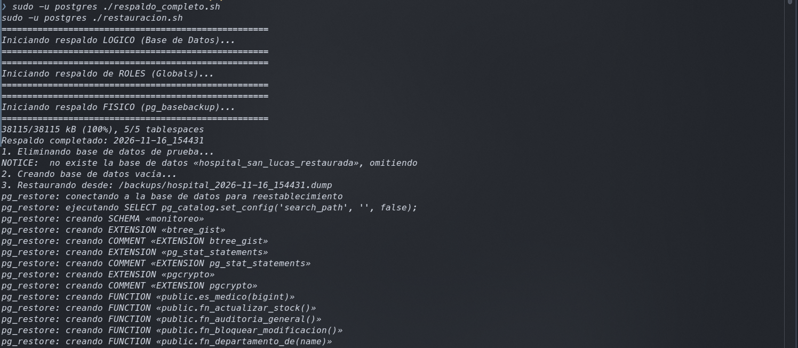
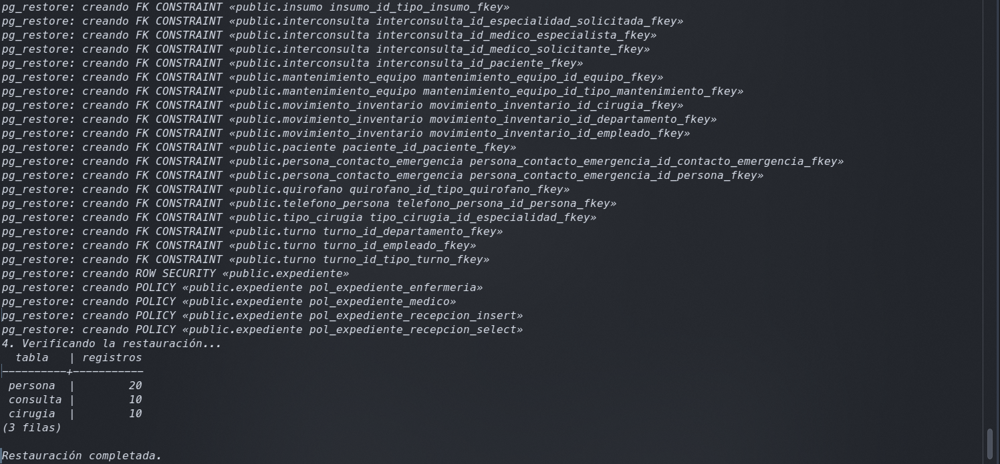
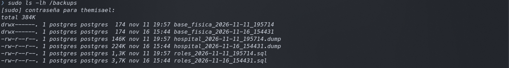
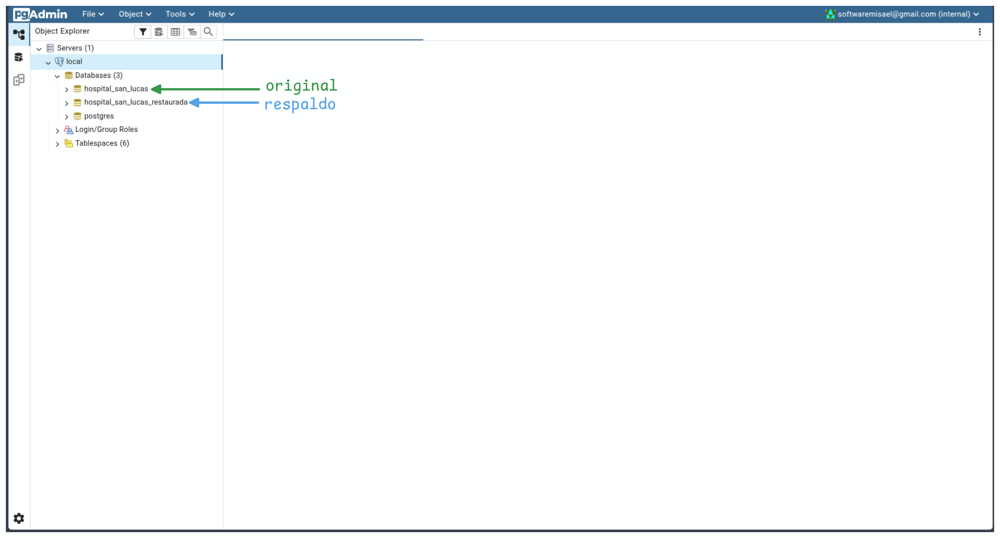

# Respaldo y Restauración — Hospital Regional "San Lucas"

## Proceso de Respaldo y Restauración

El proceso se compone de dos scripts ejecutables: `respaldo_completo.sh` (genera los respaldos) y `restauracion.sh` (restaura la base de datos). Ambos deben ejecutarse con permisos de ejecución y, preferentemente, como el usuario `postgres` para respetar la seguridad por defecto de PostgreSQL.

### 1. Otorgar permisos de ejecución y escritura

```bash
chmod +x respaldo_completo.sh restauracion.sh
sudo chown -R postgres:postgres /backups
```

Se asigna la propiedad del directorio `/backups` al usuario `postgres` para que los scripts puedan escribir los archivos generados (`pg_dump`, `pg_dumpall` y `pg_basebackup`).

### 2. Ejecutar el respaldo

```bash
sudo -u postgres ./respaldo_completo.sh
```

Este script genera un respaldo lógico de la base de datos, un respaldo global de roles y un respaldo físico (*base backup*) dentro de `/backups`.

### 3. Ejecutar la restauración

```bash
sudo -u postgres ./restauracion.sh
```

Este script restaura la base de datos a partir de los archivos generados en el paso anterior y, al finalizar, ejecuta una consulta con `psql` que muestra el conteo de registros de las tablas `persona`, `consulta` y `cirugia` como comprobación.

> **Nota:** Ejecutar como `sudo -u postgres` es la vía más rápida porque respeta la autenticación por defecto (`ident`) sin necesidad de modificar `pg_hba.conf` ni asignar contraseñas.

### Prueba

A continuación se presentan las evidencias de la ejecución del respaldo y la restauración:

<!-- Insertar imágenes aquí -->






