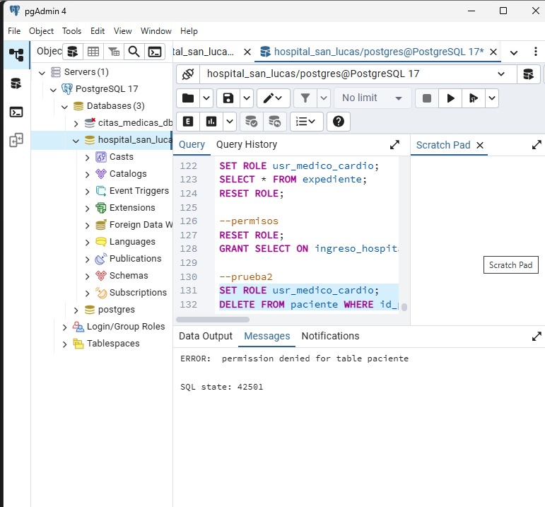
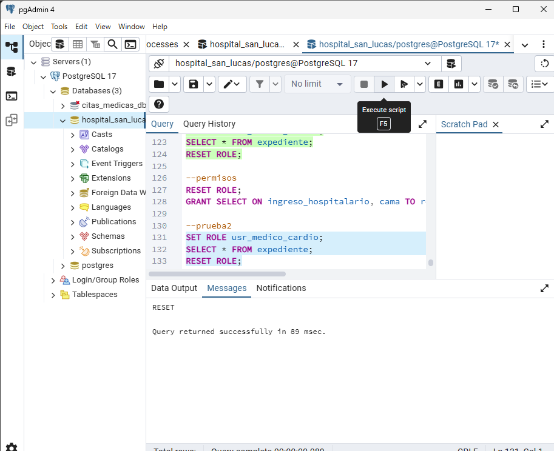
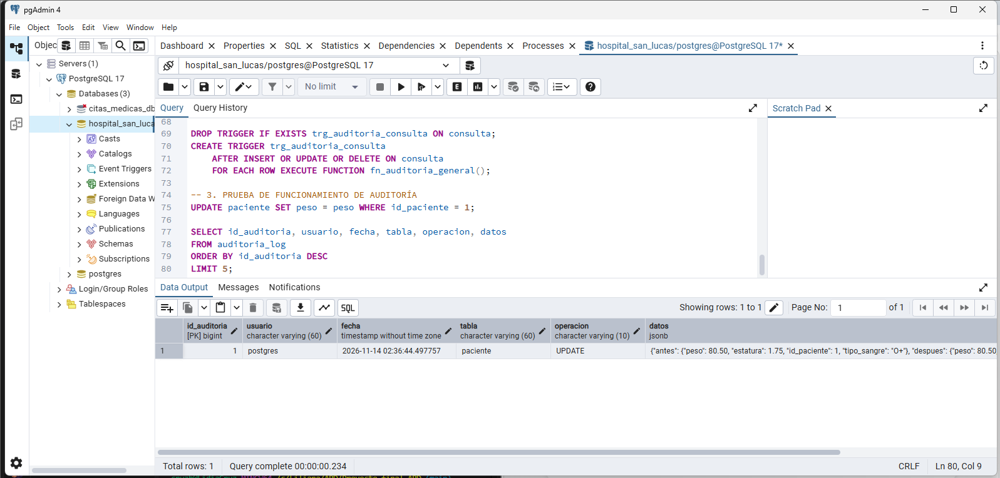
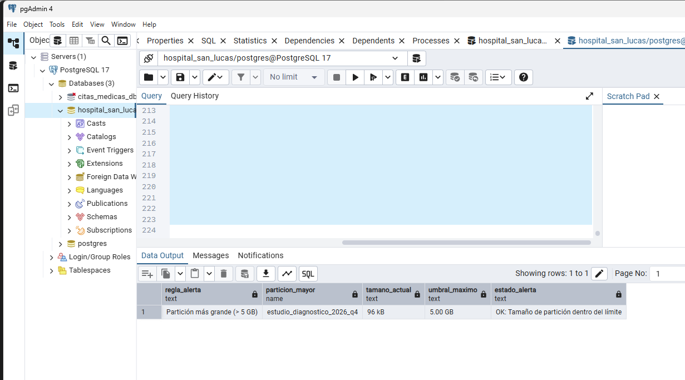

# Monitoreo, Auditoría, Control de Accesos y Administración de Almacenamiento — Hospital Regional "San Lucas"

## 1. Monitoreo, Auditoría y Control de Accesos

### 1.1 Diseño de Roles y Principio de Menor Privilegio (Ref. S13-S1)
Con el objetivo de proteger la confidencialidad e integridad de los datos clínicos en la base de datos `hospital_san_lucas`, se implementó un esquema de control de acceso basado en roles (`operaciones/04_seguridad_roles.sql`) siguiendo el principio de menor privilegio:

| Rol de Base de Datos | Usuario de Prueba | Tablas Autorizadas | Privilegios Otorgados | Restricciones Críticas |
| :--- | :--- | :--- | :--- | :--- |
| `rol_medico` | `usr_medico_cardio`, `usr_medico_pediatria` | `consulta`, `estudio_diagnostico`, catálogos clínicos, `paciente`, `expediente`, `ingreso_hospitalario`, `cama` | `SELECT`, `INSERT`, `UPDATE` en atención clínica; `SELECT` en catálogos y pacientes | Bloqueo total de `DELETE` sobre `paciente` y `expediente` |
| `rol_enfermeria` | `usr_enfermeria1` | `paciente`, `expediente`, `consulta`, `estudio_diagnostico`, `cama`, `ingreso_hospitalario`, `persona`, `departamento` | Únicamente `SELECT` | Sin permisos de escritura (`INSERT`, `UPDATE`, `DELETE`) |
| `rol_recepcion` | `usr_recepcion1` | `paciente`, `persona`, `expediente` | `SELECT`, `INSERT` | Sin acceso a diagnósticos ni modificación/borrado de registros |
| `rol_auditor` | `usr_auditor1` | `auditoria_log` | Únicamente `SELECT` | Sin acceso a datos clínicos ni alteración de la bitácora |

**Validación de restricción de borrado (`DELETE`):** Al autenticar la sesión como `usr_medico_cardio` e intentar ejecutar `DELETE FROM paciente WHERE id_paciente = 1;`, PostgreSQL rechaza la operación con el código `SQL state: 42501 (ERROR: permission denied for table paciente)`, garantizando que ningún profesional clínico pueda eliminar registros maestros de pacientes.



### 1.2 Aislamiento de Expedientes mediante Row Level Security (RLS) (Ref. S13-S1)
Para evitar que un médico consulte expedientes clínicos de pacientes que no pertenecen a su departamento de atención, se activó **Row Level Security** (`ALTER TABLE expediente ENABLE ROW LEVEL SECURITY`) junto con la política `pol_expediente_departamento_medico`:

* La política evalúa dinámicamente `current_user` contra `empleado.usuario_bd` y verifica que el paciente tenga al menos una consulta (`consulta.id_departamento`) o un ingreso hospitalario (`cama.id_departamento`) asociado al departamento del médico conectado.
* **Prueba de aislamiento:** Al ejecutar `SELECT * FROM expediente;` bajo el usuario `usr_medico_cardio` (Departamento de Cardiología, `id_departamento = 5`), el motor filtra automáticamente los resultados y devuelve únicamente el expediente del paciente atendido en Cardiología (`id_paciente = 7`), ocultando los expedientes de Pediatría (`id_departamento = 4`) y otras áreas.



### 1.3 Auditoría y Detección de Intrusiones (Ref. S13-S2)
La trazabilidad de operaciones sensibles se estructuró en dos niveles dentro de `operaciones/03_auditoria.sql`:

1. **Configuración a nivel de servidor con `pgAudit`:** Se documentó la activación de la extensión oficial `pgaudit` mediante `shared_preload_libraries = 'pgaudit'` en `postgresql.conf` y la directiva `ALTER SYSTEM SET pgaudit.log = 'ddl, role, write';` para registrar cambios estructurales (`DDL`), gestión de permisos (`ROLE`) y escrituras (`WRITE`) en los logs del servidor.
2. **Bitácora transaccional mediante Triggers (`auditoria_log`):** Se creó la tabla `auditoria_log` y la función `fn_auditoria_general()` (`SECURITY DEFINER`) asociada a triggers `AFTER INSERT OR UPDATE OR DELETE` en las tablas críticas `paciente`, `expediente` y `consulta`. Cada cambio almacena el usuario (`current_user`), marca de tiempo (`now()`), tabla afectada, tipo de operación y una instantánea en formato `JSONB` con los valores previos (`antes`) y posteriores (`despues`).



### 1.4 Métricas Vigiladas y Alertas Configuradas (`02_monitoreo.sql` y `05_alertas_espacio.sql`)
Para garantizar la disponibilidad operativa del hospital 24/7, se monitorean cuatro dimensiones críticas con sus respectivos umbrales de alerta:

| Dimensión Vigilada | Métrica / Vista de PostgreSQL | Umbral de Alerta Configurado | Acción Preventiva / Correctiva |
| :--- | :--- | :--- | :--- |
| **Espacio en disco y particiones** | `pg_database_size()`, `pg_partition_tree()`, `pg_total_relation_size()` | Espacio libre `< 20 %`; crecimiento semanal `> 2.00 GB`; partición `> 5.00 GB` | Rotación/archivado de particiones históricas y ampliación de volumen |
| **Conexiones activas** | `pg_stat_activity` vs `max_connections` | Uso `> 80 %` de `max_connections` o sesiones `idle in transaction > 10 min` | Terminación de sesiones huérfanas (`pg_terminate_backend`) y ajuste de pool |
| **Queries lentas** | `pg_stat_statements` / `pg_stat_activity` | Consultas activas `> 5 segundos` (`query > 5 s`) | Revisión de planes de ejecución (`EXPLAIN ANALYZE`) e índices |
| **Bloqueos (Locks)** | `pg_locks` + `pg_blocking_pids()` | Bloqueos activos esperando `> 3 segundos` | Identificación de transacción bloqueante y resolución de contención |



---

## 2. Administración de Almacenamiento y Mantenibilidad

### 2.1 Estrategia de Particionamiento y Retención
Las tablas de mayor crecimiento histórico (`consulta` y `estudio_diagnostico`) están particionadas por rango de fechas (`RANGE`) en trimestres (`2026_q1` a `2026_q4`), permitiendo consultas rápidas mediante *partition pruning* y facilitando la retención legal de expedientes clínicos (5 años en almacenamiento activo *hot* y traslado posterior de particiones antiguas mediante `DETACH PARTITION` hacia almacenamiento histórico *cold*).

### 2.2 Configuración de `autovacuum` por Tabla de Alto Tráfico
Dado que `consulta` y `estudio_diagnostico` reciben inserciones y actualizaciones constantes en Urgencias y Consulta Externa, el umbral predeterminado de PostgreSQL (`20 %` de tuplas muertas) resulta demasiado alto para tablas grandes. Se ajustan los parámetros de `autovacuum` a nivel de tabla para ejecutar limpiezas más frecuentes y evitar *table bloat*:

```sql
ALTER TABLE consulta SET (
    autovacuum_vacuum_scale_factor = 0.05,
    autovacuum_analyze_scale_factor = 0.02,
    autovacuum_vacuum_cost_limit = 1000
);

ALTER TABLE estudio_diagnostico SET (
    autovacuum_vacuum_scale_factor = 0.05,
    autovacuum_analyze_scale_factor = 0.02
);
```

### 2.3 Tareas de Mantenimiento Programadas y Calendario
Para conservar actualizadas las estadísticas del optimizador y evitar la fragmentación de índices B-Tree, se establece el siguiente calendario de mantenimiento fuera de horas pico (madrugada, 02:00 AM):

| Frecuencia | Tarea / Comando SQL | Alcance | Objetivo Operativo |
| :--- | :--- | :--- | :--- |
| **Diaria (02:00 AM)** | `VACUUM ANALYZE consulta, estudio_diagnostico, paciente, expediente;` | Tablas transaccionales críticas | Actualizar estadísticas del planificador y liberar espacio reutilizable |
| **Semanal (Domingos 03:00 AM)** | `VACUUM (ANALYZE) VERBOSE;` | Toda la base `hospital_san_lucas` | Saneamiento general y prevención de *transaction ID wraparound* |
| **Trimestral (Cambio de Q)** | `REINDEX TABLE CONCURRENTLY consulta; REINDEX TABLE CONCURRENTLY estudio_diagnostico;` | Índices de particiones activas | Eliminar fragmentación de índices sin bloquear lecturas/escrituras clínicas |

### 2.4 Proyección de Crecimiento y Plan de Capacidad (12–24 Meses)
Tomando como línea base un hospital regional de mediana complejidad con ~450 consultas diarias (~13,500/mes) y ~200 estudios diagnósticos diarios (~6,000/mes), incluyendo metadatos clínicos e índices:

| Horizonte Temporal | Consultas Acumuladas | Estudios Acumulados | Crecimiento Estimado Datos + Índices | Capacidad Recomendada (con margen 30 % WAL/Temp) |
| :--- | :--- | :--- | :--- | :--- |
| **Mensual (1 mes)** | ~13,500 | ~6,000 | ~380 MB / mes | — |
| **Trimestral (1 partición)** | ~40,500 | ~18,000 | ~1.14 GB / trimestre | Dentro del umbral seguro (`< 5 GB` por partición) |
| **12 Meses (1 año)** | ~162,000 | ~72,000 | ~4.56 GB | Volumen asignado: **50 GB** (uso proyectado ~9.1 %) |
| **24 Meses (2 años)** | ~324,000 | ~144,000 | ~9.12 GB | Volumen asignado: **50 GB** (uso proyectado ~18.2 %) |

### 2.5 Política de Bitácoras y Rotación de Logs
Para auditar rendimiento y eventos críticos sin saturar el disco del servidor, se definen las siguientes directivas en `postgresql.conf`:

* **Registro de consultas lentas (`log_min_duration_statement`):** Configurado en `1000` (`1 segundo`) para registrar automáticamente en la bitácora cualquier consulta que exceda dicho tiempo junto con su usuario y sentencia SQL.
* **Rotación y retención de logs:** Habilitación de `logging_collector = on`, rotación diaria o por tamaño (`log_rotation_age = 1d`, `log_rotation_size = 100MB`) con sobrescritura cíclica semanal (`log_truncate_on_rotation = on`, `log_filename = 'postgresql-%a.log'`) y archivado comprimido mensual para cumplimiento normativo hospitalario.