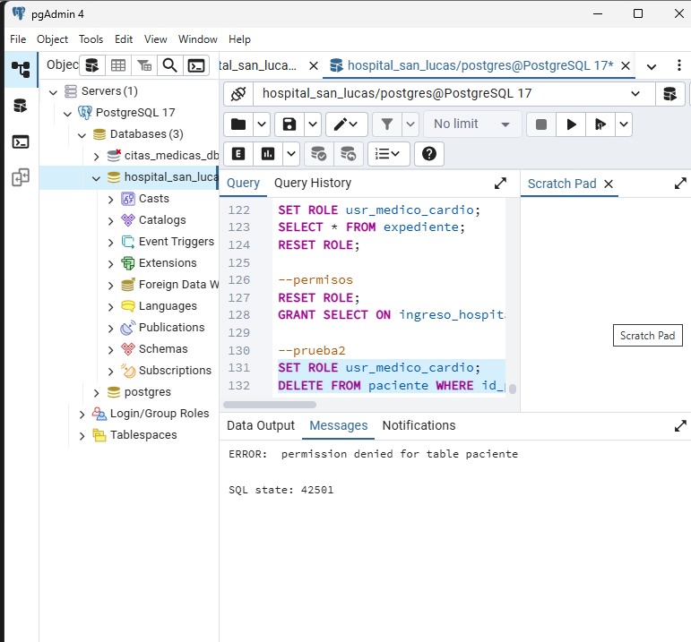
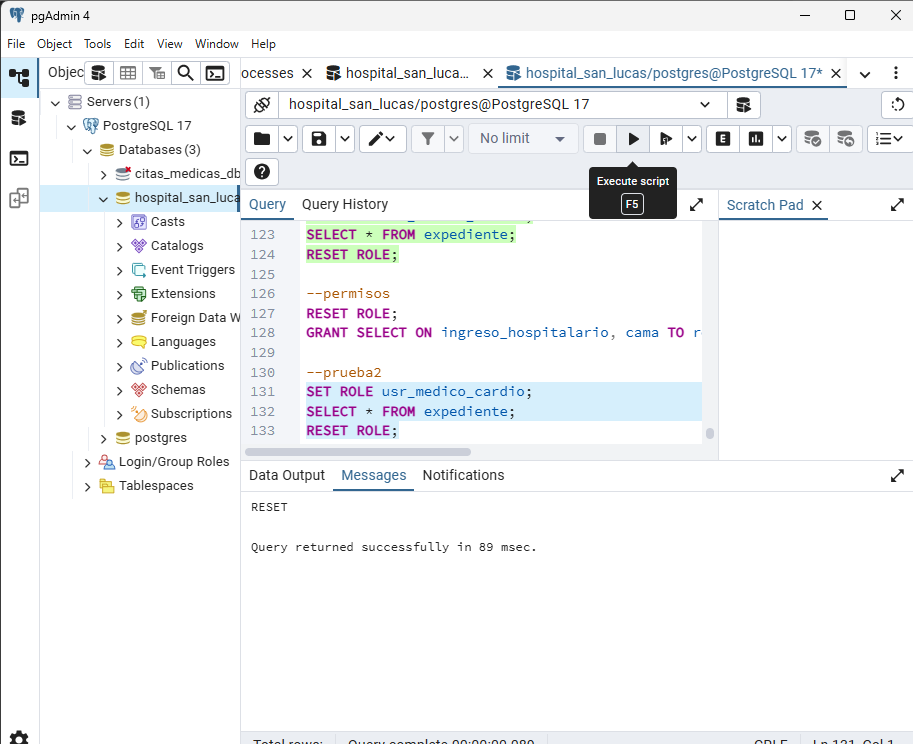
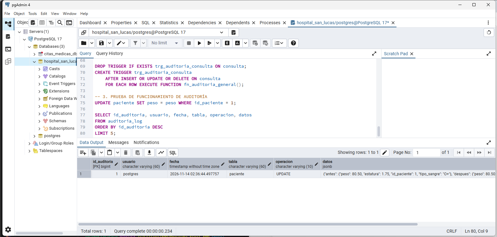
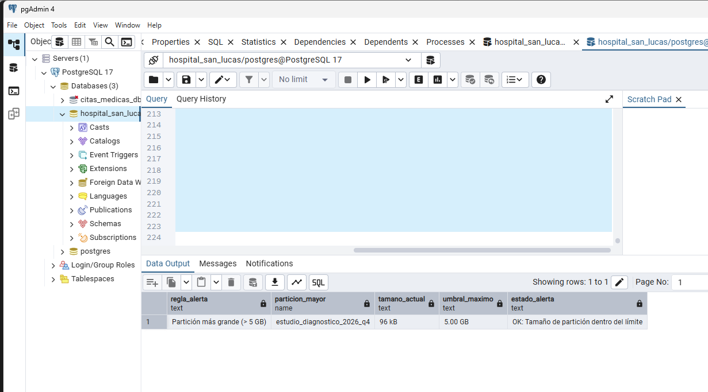

# Seguridad, Auditoría y Alertas de Almacenamiento 

## 1. Modelo de Seguridad, Control de Acceso (RBAC / RLS) y Auditoría

### 1.1 Diseño de Roles y Principio de Menor Privilegio 
Con el objetivo de proteger la confidencialidad e integridad de los datos clínicos en la base de datos `hospital_san_lucas`, se implementó un esquema de control de acceso basado en roles (`operaciones/04_seguridad_roles.sql`) siguiendo el principio de menor privilegio:

| Rol de Base de Datos | Usuario de Prueba | Tablas Autorizadas | Privilegios Otorgados | Restricciones Críticas |
| :--- | :--- | :--- | :--- | :--- |
| `rol_medico` | `usr_medico_cardio`, `usr_medico_pediatria` | `consulta`, `estudio_diagnostico`, catálogos clínicos, `paciente`, `expediente`, `ingreso_hospitalario`, `cama` | `SELECT`, `INSERT`, `UPDATE` en atención clínica; `SELECT` en catálogos y pacientes | Bloqueo total de `DELETE` sobre `paciente` y `expediente` |
| `rol_enfermeria` | `usr_enfermeria1` | `paciente`, `expediente`, `consulta`, `estudio_diagnostico`, `cama`, `ingreso_hospitalario`, `persona`, `departamento` | Únicamente `SELECT` | Sin permisos de escritura (`INSERT`, `UPDATE`, `DELETE`) |
| `rol_recepcion` | `usr_recepcion1` | `paciente`, `persona`, `expediente` | `SELECT`, `INSERT` | Sin acceso a diagnósticos ni modificación/borrado de registros |
| `rol_auditor` | `usr_auditor1` | `auditoria_log` | Únicamente `SELECT` | Sin acceso a datos clínicos ni alteración de la bitácora |

**Validación de restricción de borrado (`DELETE`):** Al autenticar la sesión como `usr_medico_cardio` e intentar ejecutar `DELETE FROM paciente WHERE id_paciente = 1;`, PostgreSQL rechaza la operación con el código `SQL state: 42501 (ERROR: permission denied for table paciente)`, garantizando que ningún profesional clínico pueda eliminar registros maestros de pacientes[cite: 12].

### 1.2 Aislamiento de Expedientes mediante Row Level Security (RLS) (Ref. S13-S1)
Para evitar que un médico consulte expedientes clínicos de pacientes que no pertenecen a su departamento de atención, se activó **Row Level Security** (`ALTER TABLE expediente ENABLE ROW LEVEL SECURITY`) junto con la política `pol_expediente_departamento_medico`:

* La política evalúa dinámicamente `current_user` contra `empleado.usuario_bd` y verifica que el paciente tenga al menos una consulta (`consulta.id_departamento`) o un ingreso hospitalario (`cama.id_departamento`) asociado al departamento del médico conectado.
* **Prueba de aislamiento:** Al ejecutar `SELECT * FROM expediente;` bajo el usuario `usr_medico_cardio` (Departamento de Cardiología, `id_departamento = 5`), el motor filtra automáticamente los resultados y devuelve únicamente el expediente del paciente atendido en Cardiología (`id_paciente = 7`), ocultando los expedientes de Pediatría (`id_departamento = 4`) y otras áreas.

### 1.3 Auditoría y Detección de Intrusiones (Ref. S13-S2)
La trazabilidad de operaciones sensibles se estructuró en dos niveles dentro de `operaciones/03_auditoria.sql`:

1. **Configuración a nivel de servidor con `pgAudit`:** Se documentó la activación de la extensión oficial `pgaudit` mediante `shared_preload_libraries = 'pgaudit'` en `postgresql.conf` y la directiva `ALTER SYSTEM SET pgaudit.log = 'ddl, role, write';` para registrar cambios estructurales (`DDL`), gestión de permisos (`ROLE`) y escrituras (`WRITE`) en los logs del servidor.
2. **Bitácora transaccional mediante Triggers (`auditoria_log`):** Se creó la tabla `auditoria_log` y la función `fn_auditoria_general()` (`SECURITY DEFINER`) asociada a triggers `AFTER INSERT OR UPDATE OR DELETE` en las tablas críticas `paciente`, `expediente` y `consulta`. Cada cambio almacena el usuario (`current_user`), marca de tiempo (`now()`), tabla afectada, tipo de operación y una instantánea en formato `JSONB` con los valores previos (`antes`) y posteriores (`despues`)[cite: 8].

---

## 2. Monitoreo Preventivo y Alertas de Almacenamiento

En complemento a las consultas de monitoreo operativo, se implementó el script `operaciones/05_alertas_espacio.sql` para evaluar de forma automatizada tres umbrales críticos de capacidad en PostgreSQL:

| Regla de Monitoreo | Umbral Definido | Métrica / Función PostgreSQL Utilizada | Resultado en Línea Base | Estado |
| :--- | :--- | :--- | :--- | :--- |
| **Espacio libre en disco** | `< 20 %` disponible | `pg_database_size(current_database())` sobre volumen de 50 GB | `> 99.9 %` disponible | `OK` |
| **Crecimiento semanal de BD** | `> 2.00 GB` en 7 días | Tabla histórica `control_crecimiento_bd` (`now() - INTERVAL '7 days'`) | `< 10 MB` (carga inicial) | `OK` |
| **Tamaño máximo por partición** | `> 5.00 GB` por partición hoja | `pg_partition_tree()` + `pg_total_relation_size()` en `consulta` y `estudio_diagnostico` | `96 kB` (`estudio_diagnostico_2026_q4`)[cite: 13] | `OK`[cite: 13] |

Este esquema preventivo permite anticipar saturaciones de almacenamiento en disco, detectar crecimientos anómalos de datos transaccionales y planificar oportunamente el archivado o creación de nuevas particiones trimestrales antes de degradar el rendimiento del hospital.

